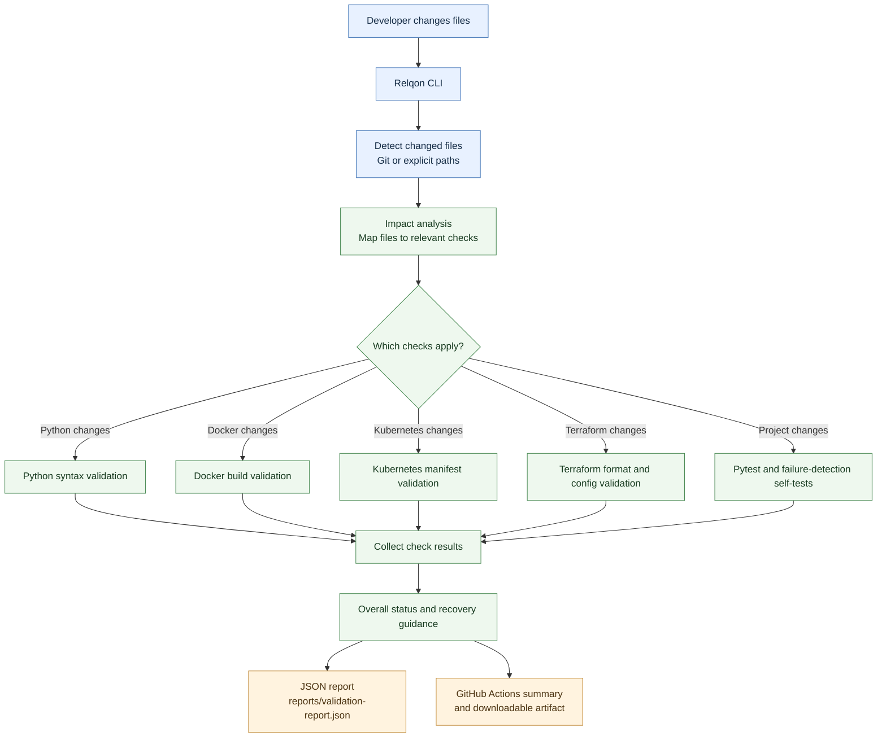

# Relqon

**Relqon** is a Python-based DevOps change-impact and validation CLI. It detects changed files, identifies relevant checks, runs validations, and writes a JSON report with results and recovery guidance.

## What it checks

- **Python** — syntax validation for changed production Python files.
- **Docker** — build validation when Docker configuration changes.
- **Kubernetes** — validation for changed Kubernetes manifests and Helm metadata.
- **Terraform** — formatting and configuration validation for changed Terraform files.
- **Pytest** — runs the project's unit tests.
- **Failure-detection self-tests** — checks expected Python and Docker failure detection.

Checks that require an unavailable tool may be marked `SKIPPED`; recovery guidance is included where available.

## Architecture

The diagram below shows how Relqon turns changed files into targeted validation results and a report.



**How to read it:** Relqon first finds changed files, then runs only the checks relevant to those changes. It combines the results into an overall status and recovery guidance. Results are written to JSON; in CI, a readable summary and report artifact are also provided. If a required external tool is unavailable, the relevant check may be marked `SKIPPED`.

## Requirements

- Python 3.10+ (use the version configured by project CI if newer).
- Git for automatic change detection.
- Optional tools for relevant checks: Docker, Terraform, and Kubernetes tooling.

Install Relqon in editable mode with its test dependencies:

```bash
python -m pip install -e ".[test]"
```

Alternatively, install runtime dependencies only with `python -m pip install -e .`.

## Run Relqon

From the repository root:

```bash
relqon run .
```

To include specific changed files explicitly:

```bash
relqon run . --changed-file src/relqon/cli.py --changed-file infra/main.tf
```

Relqon also detects staged, unstaged, and untracked files using Git. Explicit paths should be project-relative.

## JSON report

After a run, Relqon writes `reports/validation-report.json`. The report contains changed files, impact-analysis reasons, individual check results, durations, recovery guidance, and an overall status (`PASS`, `FAIL`, or `SKIPPED`).

Exit codes:

- `0` — no checks failed or were skipped.
- `1` — a validation failed or the project path is invalid.
- `2` — at least one check was skipped and no check failed.

## Run tests

```bash
python -m pytest tests/ -v --ignore=tests/python_validation/broken_test.py
```

The intentionally broken Python fixture is excluded from the normal test run because it is used by the failure-detection self-test.

## Safety and limitations

- Impact analysis ignores absolute paths and paths containing parent-directory traversal.
- Validators may be skipped when their external tools are not installed.
- Terraform validation may need provider downloads; backend initialization is disabled.
- Review the generated report and tool diagnostics before treating a validation result as deployment approval.

## CI

GitHub Actions workflows run Relqon CI checks and unit tests on repository changes. The Relqon CI workflow publishes a readable validation summary in the workflow run, including check statuses, durations, changed files, impact-analysis reasons, and recovery guidance. It also uploads `reports/validation-report.json` as the `relqon-validation-report` artifact for download. If the report cannot be generated or parsed, the workflow summary records a diagnostic message.

See the [Actions page](https://github.com/vijayreddy8/relqon/actions) to inspect recent runs and download reports.
