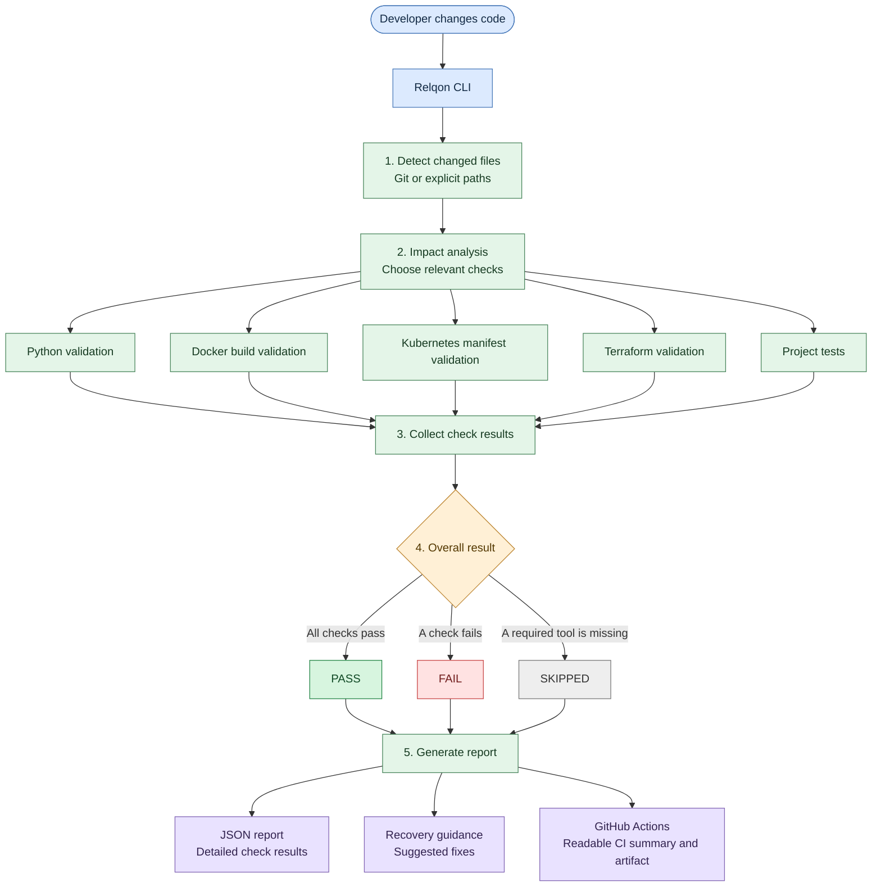

# Relqon

**Relqon** is a Python-based DevOps change-impact and validation CLI. It detects changed files, identifies relevant checks, runs validations, and writes a JSON report with results and recovery guidance.

## What it checks

- **Python** — syntax validation for changed production Python files.
- **Docker** — build validation when Docker configuration changes.
- **Kubernetes** — validation for changed Kubernetes manifests and Helm metadata.
- **Terraform** — formatting and configuration validation for changed Terraform files.
- **Pytest** — runs the project's unit tests.
- **Failure-detection self-tests** — checks expected Python and Docker failure detection.

Checks that require an unavailable tool may be marked `SKIPPED`; recovery guidance is included where available.

## Architecture

Relqon helps developers validate only what matters after code changes. This diagram shows the flow from changed files to validation results and reports.



**In short:** Relqon detects changes, selects relevant validations, collects the results, and produces a report with recovery guidance. In GitHub Actions, the run also provides a readable summary and a downloadable report artifact. Checks may be marked `SKIPPED` when a required external tool is unavailable.

## Quick start

Relqon supports Python 3.10+ on Windows, Ubuntu/Linux, and macOS. The setup scripts create a local virtual environment, upgrade `pip`, and install Relqon with its test dependencies so the `relqon` command is registered in that environment.

**Windows (PowerShell)**

```powershell
git clone https://github.com/vijayreddy8/relqon.git
cd relqon
.\scripts\setup.ps1
.\.venv\Scripts\relqon.exe run .
```

If PowerShell blocks the setup script, run it with a one-time policy override:

```powershell
powershell -ExecutionPolicy Bypass -File .\scripts\setup.ps1
```

**Ubuntu / other Linux**

```bash
git clone https://github.com/vijayreddy8/relqon.git
cd relqon
sh scripts/setup.sh
./.venv/bin/relqon run .
```

**macOS**

Use the same commands as Ubuntu/Linux. Make sure Python 3.10+ is installed.

Using the explicit executable path (`.venv/bin/relqon` on Linux/macOS or `.venv\Scripts\relqon.exe` on Windows) avoids the common “command not found” issue caused by an inactive virtual environment. If installation fails, keep the full pip error output when troubleshooting.

## Requirements

- Python 3.10+ (use the version configured by project CI if newer).
- Git for automatic change detection.
- Optional tools for relevant checks: Docker, Terraform, and Kubernetes tooling.

Install Relqon in editable mode with its test dependencies:

```bash
python -m pip install -e ".[test]"
```

Alternatively, install runtime dependencies only with `python -m pip install -e .`.

## Run Relqon

From the repository root:

```bash
relqon run .
```

To include specific changed files explicitly:

```bash
relqon run . --changed-file src/relqon/cli.py --changed-file infra/main.tf
```

Relqon also detects staged, unstaged, and untracked files using Git. Explicit paths should be project-relative.

## Terminal results and troubleshooting

After validation, Relqon prints a compact, plain-text summary designed to be readable in **PowerShell, Ubuntu/Linux shells, macOS Terminal, and the VS Code integrated terminal**. It does not depend on ANSI colors or terminal-specific formatting.

The summary includes:

- Total number of checks, with **passed**, **failed**, and **skipped** counts.
- A `[PASS]`, `[FAIL]`, or `[SKIP]` label for each check and its duration.
- Short error details for failed checks, with concise failing-test information when available.
- Suggested recovery steps for failures, plus the reason a check was skipped.
- A final overall result so engineers can quickly see whether to investigate a failure or continue.

Example output (illustrative only; real check names, counts, and messages depend on the project):

```text
====================================================================
RELQON | VALIDATION RESULTS
====================================================================
Checks: 5 total | 3 passed | 1 failed | 1 skipped
--------------------------------------------------------------------
[PASS]   Python syntax validation (0.08s)
[PASS]   Python failure detection test (0.12s)
[PASS]   Docker build validation (2.41s)
[FAIL]   Pytest unit tests (1.82s)
         FAILED tests/test_relqon.py::test_example
         Suggested fix:
           -> Run the failing Python check and inspect the first error.
[SKIP]   Terraform validation (0.01s)
         Why skipped: Terraform CLI is not installed or not in PATH.
--------------------------------------------------------------------
RESULT: FAIL - Fix the failed check(s) above, then run Relqon again.
====================================================================
```

The console output is a quick summary, not a replacement for full diagnostics. See the JSON report for structured details, and review the underlying tool output when the exact root cause is not obvious.

## JSON report

After a run, Relqon writes `reports/validation-report.json`. The report contains changed files, impact-analysis reasons, individual check results, durations, recovery guidance, and an overall status (`PASS`, `FAIL`, or `SKIPPED`).

Exit codes:

- `0` — no checks failed or were skipped.
- `1` — a validation failed or the project path is invalid.
- `2` — at least one check was skipped and no check failed.

## Run tests

```bash
python -m pytest tests/ -v --ignore=tests/python_validation/broken_test.py
```

The intentionally broken Python fixture is excluded from the normal test run because it is used by the failure-detection self-test.

## Safety and limitations

- Impact analysis ignores absolute paths and paths containing parent-directory traversal.
- Validators may be skipped when their external tools are not installed.
- Terraform validation may need provider downloads; backend initialization is disabled.
- Review the generated report and tool diagnostics before treating a validation result as deployment approval.

## CI

GitHub Actions workflows run Relqon CI checks and unit tests on repository changes. The Relqon CI workflow publishes a readable validation summary in the workflow run, including check statuses, durations, changed files, impact-analysis reasons, and recovery guidance. It also uploads `reports/validation-report.json` as the `relqon-validation-report` artifact for download. If the report cannot be generated or parsed, the workflow summary records a diagnostic message.

See the [Actions page](https://github.com/vijayreddy8/relqon/actions) to inspect recent runs and download reports.
