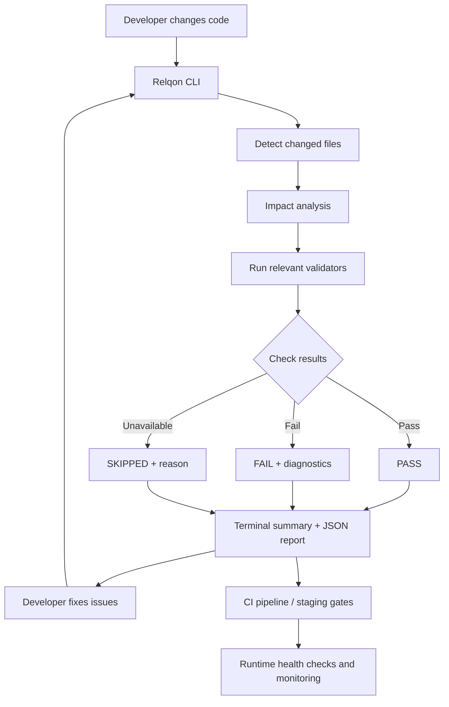

# Relqon

**Relqon** is a Python-based DevOps change-impact and validation CLI. It detects changed files, identifies relevant checks, runs available validations, prints readable diagnostics, and writes a JSON report.

> Relqon is an on-demand validation assistant. A passing build does **not** guarantee that every browser, API, database, configuration, or production runtime error has been detected. Use automated tests, staging, health checks, and runtime monitoring as well.

## What it checks

- **Python** — syntax validation for changed production Python files.
- **Node.js / TypeScript** — runs a package build when relevant JavaScript/TypeScript files or package manifests change, a build script is available, and dependencies are already installed.
- **Docker** — build validation when Docker configuration changes and Docker is available.
- **Kubernetes** — validation for changed Kubernetes manifests and Helm metadata when the relevant tools are available.
- **Terraform** — formatting and configuration validation for changed Terraform files when Terraform is available.
- **Relqon self-tests** — the optional `--full` mode runs Relqon's own test suite and failure-detection self-tests. It does not mean every test suite in the target application is automatically run.

Checks that require unavailable tools or dependencies may be marked `SKIPPED`. Review the report to see exactly what ran.

## Quick start — install Relqon

Relqon supports Python 3.10+ on Windows, Ubuntu/Linux, and macOS.

### Windows (PowerShell)

```powershell
git clone https://github.com/vijayreddy8/relqon.git
cd relqon
.\scripts\setup.ps1
.\.venv\Scripts\relqon.exe run .
```

If PowerShell blocks the setup script, use:

```powershell
powershell -ExecutionPolicy Bypass -File .\scripts\setup.ps1
```

### Ubuntu / Linux / macOS

```bash
git clone https://github.com/vijayreddy8/relqon.git
cd relqon
sh scripts/setup.sh
./.venv/bin/relqon run .
```

The default command is a **lightweight on-demand scan**. It does not run Relqon's own test suite or intentional failure simulations every time.

Run Relqon's own slower self-tests when you need to verify Relqon itself:

```powershell
# Windows PowerShell
.\.venv\Scripts\relqon.exe run . --full
```

```bash
# Linux/macOS
./.venv/bin/relqon run . --full
```

## Developer and DevOps workflow for an application

Use the following workflow from the **application repository root** (the folder containing the application's frontend/backend folders and/or package manifests). Do not run the command from the Relqon source folder if you intend to scan a different application.

### 1. Check the working tree

```powershell
git status --short
git diff --stat
```

Review the changed files and avoid committing test-only mistakes, secrets, local uploads, generated build output, or environment files.

### 2. Run Relqon against the application

If Relqon is installed in a separate folder on Windows, call its executable by full path. Example:

```powershell
& "C:\Users\<your-user>\relqon\.venv\Scripts\relqon.exe" run .
```

Replace the example path with the actual location of your Relqon virtual environment. Run this command while the terminal's current directory is the **application root**.

On Linux/macOS, if Relqon is installed in a separate path, use that environment's executable:

```bash
/path/to/relqon/.venv/bin/relqon run .
```

Relqon detects staged, unstaged, and untracked files using Git and selects relevant checks. To explicitly include a changed file (for example, when Git detection does not include it), use project-relative paths:

```powershell
& "C:\Users\<your-user>\relqon\.venv\Scripts\relqon.exe" run . --changed-file frontend/src/App.tsx
```

You can repeat `--changed-file` for multiple paths. Explicit inclusion asks Relqon to consider the path; the check still depends on the package scripts, dependencies, and supported validators available in the target project.

### 3. Read the result before deploying

- **PASS** — checks that ran passed. Continue with the project's required tests and deployment gates.
- **FAIL** — stop and investigate the failed check. Read the compiler/test output and fix the root cause before rerunning.
- **SKIPPED** — a check did not run, commonly because a tool, dependency, or supported build script was unavailable. A skipped check is not a pass.
- **No changed files detected** — verify the current directory, Git status, and whether the file is tracked/untracked or needs explicit `--changed-file`.

Relqon writes a JSON report at `reports/validation-report.json` **inside the target application root**.

### 4. Run application-specific build and tests

Relqon runs validations it can identify from the changed files and project configuration. For a multi-package application, verify frontend and backend checks independently if the summary does not show both.

Example for a React/Vite frontend and an Express/TypeScript backend:

```powershell
# From the application root: frontend production build
npm --prefix frontend run build

# From the application root: backend production build
npm --prefix backend run build
```

These commands assume both packages define a `build` script. Check the relevant `package.json` if a script is missing. Run the project's unit and integration tests as documented by that project; Relqon's `--full` flag is for Relqon's own tests, not a substitute for application tests.

Only install or restore dependencies when needed. If a package's lockfile changed and the dependency tree needs to be synchronized, run the appropriate package-manager install command from that package directory (for npm, `npm ci` requires a valid lockfile and removes/recreates `node_modules`). Do not reinstall dependencies blindly as a first troubleshooting step.

### 5. Deployment and runtime checks

A successful TypeScript/build check catches compiler and bundling failures, but it cannot prove that the deployed application works end to end. Before production, use the project's normal pipeline to include:

1. Unit and integration tests.
2. Frontend browser/e2e tests for important user journeys.
3. Backend API tests and database connectivity/migration checks.
4. Secret and environment-variable validation without printing secret values.
5. Container image build and vulnerability checks where applicable.
6. Staging deployment and HTTP/API health checks.
7. Runtime monitoring and logs for errors that occur only after deployment.

For Docker Compose projects, validate the Compose configuration with the project's configured Docker tooling before deploying. For Kubernetes, validate manifests and confirm rollout/health status after deployment. Commands and checks depend on the application's actual infrastructure.

## Example: understanding TypeScript build failures

A Relqon run against a React/Vite application reported the following diagnostics:

```text
src/App.tsx(35,15): error TS2339: Property 'env' does not exist on type 'ImportMeta'.
src/App.tsx(901,7): error TS2322: Type 'string' is not assignable to type 'number'.
src/components/ProfileEditor.tsx(4,25): error TS2339: Property 'env' does not exist on type 'ImportMeta'.
```

How to triage:

- **TS2322** means a string is being used where a number is expected. Inspect the reported line and nearby types; determine whether the value or the declared type is wrong before changing code.
- **`import.meta.env` TS2339** in a Vite app often indicates that Vite client type declarations are missing or not included by the active TypeScript configuration. Check the project's Vite type declaration (commonly `vite/client`) and TypeScript config before editing application logic.
- Fix the underlying issue, rerun the same Relqon command, and inspect the new result. Do not treat a suggested generic recovery step as a guaranteed fix.

The example above documents a real diagnostic pattern; it does not imply that these issues are automatically fixed by Relqon.

## Terminal results and troubleshooting

The plain-text summary is designed for PowerShell, Linux/macOS shells, and the VS Code integrated terminal. It includes:

- Total checks with passed, failed, and skipped counts.
- A `[PASS]`, `[FAIL]`, or `[SKIP]` label and duration for each check.
- Short diagnostics for failed checks, including Node.js/TypeScript compiler output when available.
- Recovery suggestions and skip reasons.
- An overall result.

Example output (illustrative only):

```text
====================================================================
RELQON | VALIDATION RESULTS
====================================================================
Checks: 2 total | 1 passed | 1 failed | 0 skipped
--------------------------------------------------------------------
[PASS]   Python syntax validation (0.08s)
[FAIL]   Node.js build validation (28.43s)
         src/App.tsx(901,7): error TS2322: Type 'string' is not assignable to type 'number'.
--------------------------------------------------------------------
RESULT: FAIL - Fix the failed check(s) above, then run Relqon again.
====================================================================

JSON report saved: reports/validation-report.json
```

The console output is a quick summary, not a replacement for complete diagnostics. See the JSON report and the underlying tool output when the cause is not obvious.

## JSON report and exit codes

The report at `reports/validation-report.json` contains changed files, impact-analysis reasons, individual check results, durations, recovery guidance, and an overall status.

Exit codes:

- `0` — no checks failed or were skipped.
- `1` — a validation failed or the project path is invalid.
- `2` — at least one check was skipped and no check failed.

## Requirements

- Python 3.10+.
- Git for automatic change detection.
- Optional external tools for relevant checks: Node.js/npm, Docker, Terraform, and Kubernetes tooling.
- For Node.js builds, the target package must have a build script and its dependencies must already be installed; Relqon does not automatically install application dependencies.

Install Relqon in editable mode with test dependencies:

```bash
python -m pip install -e ".[test]"
```

Or install runtime dependencies only:

```bash
python -m pip install -e .
```

## Run Relqon tests

From the Relqon repository root:

```bash
python -m pytest tests/ -v --ignore=tests/python_validation/broken_test.py
```

The intentionally broken Python fixture is excluded from the normal test run because it is used by the failure-detection self-test.

## Architecture



## Safety and limitations

- Relqon is a validation aid, not a guarantee that a release is production-safe.
- Static/build checks do not detect every runtime, browser, API, database, network, or infrastructure failure.
- Impact analysis ignores absolute paths and paths containing parent-directory traversal.
- Validators may be skipped when external tools, dependencies, or expected package scripts are unavailable.
- Terraform validation may need provider downloads; backend initialization is disabled.
- Review the generated report and diagnostics before treating a validation result as deployment approval.
- Avoid committing secrets, personal uploads, generated reports, or intentional test failures unless your repository explicitly requires them.

## CI

GitHub Actions workflows run Relqon CI checks and unit tests on repository changes. The Relqon CI workflow publishes a readable validation summary and uploads `reports/validation-report.json` as the `relqon-validation-report` artifact when generated.

See the [Actions page](https://github.com/vijayreddy8/relqon/actions) to inspect recent runs and download reports.
